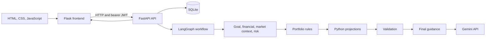

# InvestWise AI


InvestWise AI is an educational investment-planning web application that combines a Flask interface, a FastAPI backend, deterministic financial calculations, and Gemini-generated explanations.

> **Disclaimer:** This project is for educational purposes only. Its projections and allocation examples are illustrative, are not professional financial advice, and do not guarantee returns.

## Overview

Users can record financial goals and profile information, complete a risk questionnaire, and run a multi-agent analysis. The application calculates scenario projections in Python and uses Gemini for concise explanations, chat, and a grounded market-context pass where available.

## Features

- Register, log in, and sign out; password hashes use bcrypt and access tokens use JWT.
- Create, view, update, and delete investment goals.
- Save financial-profile and risk-assessment information.
- Run an analysis that combines goal, financial, risk, portfolio, scenario, and validation steps.
- Compare expected, optimistic, and pessimistic what-if projections.
- Review analysis results and ask contextual questions in the chat.
- Use a SQLite database with Alembic-managed schema revisions.
- Apply bounded Gemini retries, optional model fallback, per-process request limiting, and in-memory response caching.

Portfolio allocations use fixed rules based on the risk category. They are examples for planning and are not optimized investment advice. The market API endpoint reports that research is available during analysis; it does not itself fetch current market data.

## Architecture



The independent goal, financial, market-context, and risk nodes run in parallel and merge results into shared state. Portfolio construction, scenario calculation, validation, and final guidance then run in sequence. Financial projections are calculated by Python, not by the LLM.

## Technology

| Area | Technologies |
|---|---|
| Language | Python 3.11–3.13 |
| Web UI | Flask, Jinja templates, HTML, CSS, JavaScript |
| API | FastAPI, Uvicorn |
| Workflow | LangGraph |
| Persistence | SQLite, Alembic, SQLAlchemy metadata |
| Validation and settings | Pydantic, pydantic-settings |
| AI integration | Google Gemini (`google-genai`) |
| Authentication | JWT (`python-jose`), bcrypt |
| HTTP client | Requests |
| Tests | pytest, pytest-asyncio |

## Project structure

```text
CODE/
├── BACKEND/
│   ├── alembic.ini
│   ├── alembic/
│   │   ├── env.py
│   │   └── versions/
│   ├── app/
│   │   ├── agents/          # Goal, financial, risk, market, portfolio, scenario, critic, final
│   │   ├── api/             # FastAPI route handlers
│   │   ├── calculations/    # Deterministic projections and risk calculations
│   │   ├── database/        # SQLite connection and SQLAlchemy metadata
│   │   ├── schemas/         # Pydantic request/response models
│   │   ├── services/        # Gemini and authentication services
│   │   ├── workflow/        # LangGraph graph and shared state
│   │   ├── config.py
│   │   └── main.py
│   └── tests/
├── DATA_BASE/               # Local SQLite database location
├── FRONTEND/
│   ├── services/api_client.py
│   ├── static/              # CSS and JavaScript
│   ├── templates/           # Jinja pages
│   └── app.py
├── .env.example
├── .gitignore
├── pyproject.toml
├── uv.lock
└── README.md
```

## Prerequisites

- Python 3.11, 3.12, or 3.13.
- [uv](https://docs.astral.sh/uv/) for dependency management.
- A Gemini API key for Gemini-powered explanations and chat.
- Windows PowerShell or another command shell.

SQLite is included with Python; no separate database server is needed.

## Setup

Run commands from the project root (`CODE`).

1. Install uv if it is not already installed:

   ```powershell
   py -3.12 -m pip install uv
   ```

2. Install the locked dependencies:

   ```powershell
   uv sync
   ```

3. Create a local environment file and edit it:

   ```powershell
   Copy-Item .env.example .env
   notepad .env
   ```

   Set `GEMINI_API_KEY` to your own key. Replace the sample `SECRET_KEY` with a randomly generated value:

   ```powershell
   py -c "import secrets; print(secrets.token_urlsafe(48))"
   ```

   The backend intentionally rejects the placeholder values from `.env.example`. Do not commit `.env` or share API keys.

4. Apply the database migrations:

   ```powershell
   uv run alembic -c BACKEND\alembic.ini upgrade head
   ```

   For a pre-existing database created by the original app schema, back up the database first, then mark the initial schema and apply the revocation-table migration:

   ```powershell
   uv run alembic -c BACKEND\alembic.ini stamp 0001_initial
   uv run alembic -c BACKEND\alembic.ini upgrade head
   ```

   Only use `stamp` when that database already contains the original application tables. A new database should use `upgrade head` directly.

## Configuration

The backend loads `.env` from the project root. `GEMINI_API_KEY`, `DATABASE_URL`, and `SECRET_KEY` are required at startup.
The checked-in `.env.example` selects `gemini-3.8-flash`; choose a model
available to your Gemini account if that example is not enabled for you.
When `GEMINI_MODEL` is omitted, the application setting defaults to
`gemini-3.6-flash`.

| Variable | Required | Purpose |
|---|---:|---|
| `GEMINI_API_KEY` | Yes | Google Gemini API credential. |
| `DATABASE_URL` | Yes | Persistent SQLite URL; the sample stores data in `DATA_BASE\investment.db`. |
| `SECRET_KEY` | Yes | At least 32 characters; signs JWTs and protects the Flask session. Use a randomly generated value. |
| `GEMINI_MODEL` | No | Primary Gemini model; defaults to `gemini-3.6-flash` in application settings. |
| `GEMINI_FALLBACK_MODEL` | No | Optional model to try if the primary Gemini call fails. |
| `ACCESS_TOKEN_EXPIRE_MINUTES` | No | JWT lifetime in minutes; defaults to 60. |
| `FRONTEND_ORIGIN` | No | One explicit CORS origin; defaults to `http://127.0.0.1:5000`. Wildcards are rejected. |
| `BACKEND_URL` | No | Backend URL used by Flask; defaults to `http://127.0.0.1:8000`. |
| `FLASK_HOST` | No | Flask bind host; defaults to `127.0.0.1`. |
| `FLASK_PORT` | No | Flask port; defaults to `5000`. |
| `FLASK_DEBUG` | No | Flask debug flag; defaults to `true`. Disable debug outside local development. |
| `APP_NAME` | No | FastAPI title; defaults to `Investment Guidance AI`. |
| `DEBUG` | No | Application setting, default `true`. |

The Gemini request limiter and response cache are in-memory and apply to one backend process: up to 15 Gemini requests per minute, with up to three attempts for transient failures. Successful text responses are cached for five minutes, up to 128 entries.

## Run locally

Start the backend in one terminal:

```powershell
Set-Location BACKEND
uv run uvicorn app.main:app --host 127.0.0.1 --port 8000 --reload
```

Start the Flask frontend in a second terminal:

```powershell
Set-Location FRONTEND
uv run python app.py
```

- Frontend: <http://127.0.0.1:5000>
- Backend health: <http://127.0.0.1:8000/health>
- Interactive API documentation: <http://127.0.0.1:8000/docs>

The Flask frontend calls the backend over HTTP. Configure `BACKEND_URL` and `FRONTEND_ORIGIN` to match the addresses used in your environment.

## API

All `/api` endpoints below require a bearer JWT except registration and login. Logout requires the current bearer token. FastAPI also provides `GET /` and `GET /health`.

| Method | Endpoint | Description |
|---|---|---|
| `POST` | `/api/auth/register` | Register a user and return an access token. |
| `POST` | `/api/auth/login` | Authenticate and return an access token. |
| `POST` | `/api/auth/logout` | Revoke the current access token. |
| `GET` | `/api/goals` | List the authenticated user's goals. |
| `POST` | `/api/goals` | Create a goal. |
| `GET` | `/api/goals/{goal_id}` | Get one owned goal. |
| `PUT` | `/api/goals/{goal_id}` | Update an owned goal. |
| `DELETE` | `/api/goals/{goal_id}` | Delete an owned goal. |
| `POST` | `/api/analysis/{goal_id}` | Run the multi-agent analysis for a goal. |
| `GET` | `/api/analysis/{analysis_id}` | Retrieve a saved analysis row. |
| `POST` | `/api/what-if` | Calculate scenarios for changed contribution or horizon. |
| `POST` | `/api/chat` | Ask a question using goal and analysis context. |
| `GET` | `/api/profile` | Get the financial profile. |
| `POST` | `/api/profile` | Save the financial profile. |
| `GET` | `/api/risk` | Get the latest saved risk profile. |
| `POST` | `/api/risk` | Save risk answers and the resulting category. |
| `GET` | `/api/market/{symbol}` | Return market endpoint status; research is part of analysis. |

The request schemas and interactive API docs are available in the source and at `/docs` while the backend is running.

## Tests

With dependencies installed and the required environment variables configured, run:

```powershell
uv run pytest BACKEND\tests -q
```

The tests cover workflow calculations, state merging, Gemini retry and caching behavior, settings validation, password hashing, and JWT expiry/revocation.

## Limitations and security notes

- This is an educational project, not a financial-advice or trading system.
- Portfolio allocation rules and scenario return assumptions are simplified and illustrative.
- Gemini output and market context can be unavailable or inaccurate; verify time-sensitive information independently.
- SQLite and in-memory rate limiting are intended for local/small-scale use, not multi-instance production deployment.
- The default development settings enable Flask debug mode and the backend run command enables Uvicorn reload. Do not expose these development servers publicly.
- There is no password reset or multi-factor authentication flow.

## Contributing

1. Create a branch for your change.
2. Keep changes focused and avoid committing `.env`, database files, virtual environments, and generated caches.
3. Run the tests and describe any relevant behavior changes in your pull request.

## License

No project license file is present. Unless a license is added, reuse and redistribution permissions are not specified.
